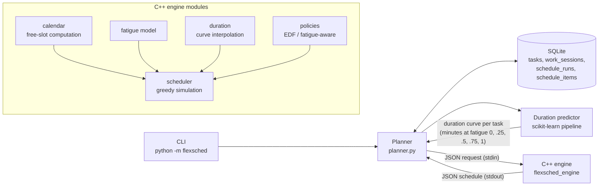

# FLEXSched – Intelligent Task Scheduler & Planner

**A fatigue-aware task scheduler.** FLEXSched learns how long *you* really take
from your work history (scikit-learn), simulates how tired you get during the day,
and builds a timetable with a C++ scheduling engine that puts demanding work where
you have the energy for it, inserts recovery breaks and still protects deadlines.

| | |
|---|---|
| **Languages** | Python 3.10+, C++17 |
| **ML** | scikit-learn (Ridge, Random Forest, Gradient Boosting), pandas, NumPy |
| **Storage** | SQLite (4 tables, constraints, indexes, transactions) |
| **Testing** | Catch2 v3 (C++ engine, 39 test cases), pytest (49 tests), GitHub Actions CI |
| **Build** | CMake + FetchContent (Catch2, nlohmann/json) |

---

## Why

People are bad at estimating ("planning fallacy") and get slower when tired, yet
classic schedulers treat a task's duration as a fixed number. FLEXSched treats
duration as a **function of fatigue** and schedules accordingly.

## Architecture



* **Python** owns data, ML and orchestration.
* **C++** owns the scheduling algorithm: a standalone executable speaking JSON over
  stdin/stdout, testable on its own with Catch2.

## How it works (one paragraph each)

1. **Fatigue model** – fatigue `F ∈ [0,1]` grows while working
   (`F' = 1-(1-F)·e^(-rate·load·minutes)`, harder tasks = higher load) and decays
   exponentially while resting (`F' = F·e^(-recovery·minutes)`).
2. **Duration prediction** – a scikit-learn pipeline predicts the ratio
   *actual / estimate* from category, difficulty, priority, fatigue, time of day and
   weekday. The best model is picked by time-series cross-validation against two
   baselines and asked for durations at 5 fatigue levels, giving a **duration curve**.
3. **Scheduling** – the engine walks through the free slots (working hours minus
   blocked time), tracks fatigue, and at every decision point asks a policy which
   fitting task to do next. The **fatigue-aware policy** scores priority, deadline
   urgency and *energy match* (hard tasks when fresh, easy ones when tired), takes
   breaks above a fatigue threshold, and uses a **rollout deadline guard** so it
   never picks a task that would cause more lateness than Earliest-Deadline-First.

## Results (reproducible: `seed` → `train` → `benchmark --scenarios 200`)

> Data is synthetic (see `flexsched/synthetic.py` for the simulated user's hidden
> habits). The numbers show the pipeline recovers such patterns; they are not a claim
> about real users.

**Duration prediction** – 445 sessions, temporal 80/20 split:

| model | CV MAE (min) | hold-out MAE (min) | MAPE | R² |
|---|---|---|---|---|
| trust your estimate (baseline) | 15.55 | 17.47 | 21.5% | 0.614 |
| mean ratio (baseline) | 13.39 | 14.04 | 20.3% | 0.763 |
| **ridge (chosen by CV)** | **7.20** | **6.68** | **10.0%** | **0.938** |
| random forest | 8.58 | 7.08 | 10.3% | 0.932 |
| gradient boosting | 7.93 | 6.91 | 11.1% | 0.943 |

→ **62% lower error** than trusting the user's own estimate.

**Scheduling** – 200 random scenarios (8–14 tasks, 2 days, lunch block), same input
for both strategies:

| metric (mean) | fatigue-aware | EDF baseline |
|---|---|---|
| avg fatigue at task start | **0.265** (−17%) | 0.321 |
| peak fatigue | **0.783** (−7%) | 0.842 |
| total work minutes | **653.9** (−1.6%) | 664.3 |
| total lateness (min) | 90.4 | 90.9 |
| late tasks | 0.43 | 0.32 |

Fatigue-aware has lower average fatigue in 80% of scenarios and lower peak fatigue
in 82%, at the same total lateness. The trade-off is slightly more (but shorter)
late tasks.

## Quick start

Prerequisites: Python ≥ 3.10, CMake ≥ 3.16, a C++17 compiler (GCC, Clang or MSVC),
internet access on first configure (CMake downloads Catch2 and nlohmann/json).

```bash
# 1. Build the C++ engine and run its unit tests
cmake -S engine -B build -DCMAKE_BUILD_TYPE=Release
cmake --build build --config Release
ctest --test-dir build -C Release

# 2. Python environment
python -m venv .venv
# Windows: .venv\Scripts\activate    macOS/Linux: source .venv/bin/activate
pip install -r requirements.txt
python -m pytest

# 3. See everything working end to end (uses a temporary database)
python -m flexsched demo
```

## CLI usage

```bash
python -m flexsched seed --days 120          # synthetic history (for demos)
python -m flexsched train                    # train + compare models, save the best
python -m flexsched stats                    # how wrong are my estimates, per category?

python -m flexsched add "Implement auth" -c coding -d 5 -p 5 -e 120 --deadline "2026-10-09 17:00"
python -m flexsched list
python -m flexsched plan --start tomorrow --days 3 --block "2026-10-07 13:00-14:00"
python -m flexsched compare --start tomorrow --days 3
python -m flexsched done 12 --start "2026-10-07 09:00" --minutes 95   # log real work
python -m flexsched runs                     # saved schedules
python -m flexsched benchmark --scenarios 200
```

The engine can also be used on its own:

```bash
build/flexsched_engine < engine/examples/request.json
```

## Project structure

```
engine/                     C++17 scheduling engine
  include/flexsched/        headers: types, fatigue, duration, calendar, policy, scheduler, json_io
  src/                      implementations + main.cpp (CLI entry point)
  tests/                    Catch2 unit tests (one file per module)
  examples/request.json     sample engine input
flexsched/                  Python package
  config.py                 paths and parameters (single source of truth)
  models.py                 dataclasses: Task, WorkSession, PlannedBlock, PlanResult
  schema.sql, db.py         SQLite schema and connection handling
  repository.py             all SQL (repository pattern)
  fatigue.py                Python mirror of the fatigue model
  synthetic.py              synthetic history generator
  predictor.py              ML training, evaluation, duration curves
  engine_bridge.py          subprocess + JSON bridge to the engine
  planner.py                orchestration (DB -> ML -> engine -> DB)
  benchmark.py              strategy comparison on random scenarios
  cli.py                    argparse command-line interface
tests/                      pytest suite (unit + engine integration + CLI)
docs/
  PROJECT_GUIDE.md / .pdf   full walkthrough: concepts, code, design, interview prep
  FUTURE_ROADMAP.md         path to a production-grade product
```

## Documentation

* [`docs/PROJECT_GUIDE.md`](docs/PROJECT_GUIDE.md) – a complete guide to the
  project: tech stack primers, every module explained line by line, algorithms,
  testing, results, limitations and an interview question bank.
* [`docs/FUTURE_ROADMAP.md`](docs/FUTURE_ROADMAP.md) – how to grow this into a
  production-grade product.

## License

MIT – see [LICENSE](LICENSE).
